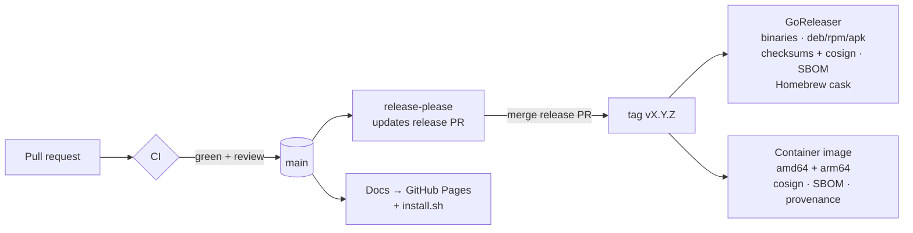

# Releases & CI/CD

Everything from a pull request to a published, signed release is automated. Nobody builds or uploads anything by hand.

## The pipeline



## Workflows

| Workflow | When | What it does |
|---|---|---|
| **CI** `ci.yml` | every PR, push to `main` | tests with `-race` on Linux **and** macOS; `go mod tidy` check; golangci-lint + ShellCheck; govulncheck; **gitleaks** secret scan; refuses committed `.pem/.key/.crt/.pfx/.env`; cross-build for 6 platforms; GoReleaser dry run; Docker build + smoke test; docs build in strict mode (broken links fail) |
| **PR title** `pr-title.yml` | every PR | the title must be a [Conventional Commit](https://www.conventionalcommits.org), because it becomes the changelog entry |
| **CodeQL** `codeql.yml` | PRs, `main`, weekly | static security analysis (`security-extended`) |
| **Scorecard** `scorecard.yml` | `main`, weekly | [OpenSSF Scorecard](https://scorecard.dev) supply-chain rating and the README badge |
| **Release** `release.yml` | push to `main` | release-please → GoReleaser → container image (below) |
| **Docs** `docs.yml` | changes to `docs/`, `*.md`, `install.sh` | builds this site and publishes it, with `install.sh`, to GitHub Pages |
| **Dependabot** | weekly | updates Go modules, GitHub Actions (pinned by SHA), base image, docs tooling |

Every third-party action is **pinned to a commit SHA** and every job starts with least-privilege `permissions`. [harden-runner](https://github.com/step-security/harden-runner) audits network egress during builds.

## How a version is chosen

You never pick version numbers. [release-please](https://github.com/googleapis/release-please) reads the commit titles merged since the last release:

| Commit title | Next version (from 1.4.2) |
|---|---|
| `fix: …` | 1.4.**3** |
| `feat: …` | 1.**5**.0 |
| `feat!: …` or a `BREAKING CHANGE:` footer | **2**.0.0 |
| `docs:`, `chore:`, `ci:`, `test:`, `refactor:` | no release on their own |

Before 1.0, breaking changes bump the minor version.

It keeps one pull request open, *"chore(main): release x.y.z"*, with the new version and the `CHANGELOG.md` entries. **Merging that PR publishes the release.**

## What a release contains

| Asset | For |
|---|---|
| `sslsync_X.Y.Z_{darwin,linux,windows}_{amd64,arm64}.tar.gz/.zip` | the install script, manual download |
| `sslsync_X.Y.Z_linux_{amd64,arm64}.{deb,rpm,apk}` | `dpkg -i`, `rpm -i`, `apk add` |
| `checksums.txt` + `checksums.txt.sigstore.json` | integrity; signed keyless with cosign by this repository's workflow |
| `*.sbom.json` | software bill of materials per archive |
| build provenance attestations | `gh attestation verify <file> --repo ilramdhan/sslsync` |
| `ghcr.io/ilramdhan/sslsync:X.Y.Z`, `:X.Y`, `:X`, `:latest` | Docker; multi-arch, signed, with SBOM and SLSA provenance |
| Homebrew cask in `ilramdhan/homebrew-tap` | `brew install --cask ilramdhan/tap/sslsync` |

Builds are reproducible: `-trimpath` plus the commit timestamp as the file time.

## Verifying a release

```bash
# checksums signature, then the archive
cosign verify-blob --bundle checksums.txt.sigstore.json \
  --certificate-identity-regexp 'https://github.com/ilramdhan/sslsync/' \
  --certificate-oidc-issuer https://token.actions.githubusercontent.com checksums.txt
sha256sum --ignore-missing -c checksums.txt

# provenance: which workflow built it, from which commit
gh attestation verify sslsync_*_linux_amd64.tar.gz --repo ilramdhan/sslsync

# container image
cosign verify ghcr.io/ilramdhan/sslsync:latest \
  --certificate-identity-regexp 'https://github.com/ilramdhan/sslsync/' \
  --certificate-oidc-issuer https://token.actions.githubusercontent.com
```

## One-time repository setup (maintainer)

1. **Settings → Actions → General → Workflow permissions**: *Read repository contents*, and tick *Allow GitHub Actions to create and approve pull requests* (release-please).
2. **Settings → Pages → Source**: *GitHub Actions*.
3. **Settings → Code security**: enable *Private vulnerability reporting*, *Dependabot alerts / security updates*, *Secret scanning* + *Push protection*.
4. **Settings → Rules → Rulesets** for `main`: require a pull request with 1 approval from code owners, require status checks (`Test (ubuntu-latest)`, `Test (macos-latest)`, `Lint`, `Security`, `Build …`, `Release config`, `Docker image`, `Docs build`, `conventional`, `analyze`), block force pushes, require linear history, and allow squash merge only.
5. **Homebrew** (optional): create the public repo `ilramdhan/homebrew-tap`, then a fine-grained token with *Contents: read & write* on only that repo, saved as the Actions secret `HOMEBREW_TAP_TOKEN`. Without it, everything except the cask is still released.
6. **Packages**: after the first release, set `ghcr.io/ilramdhan/sslsync` to *Public* (Package settings → Change visibility).
